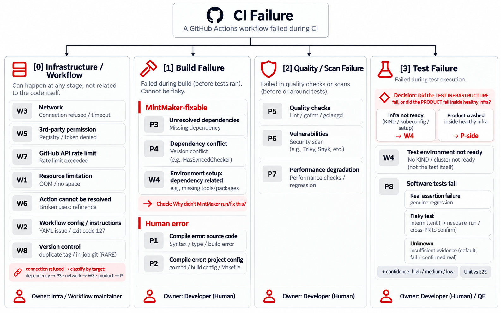

# CI Failure Analysis — Process, Method, Results, and Conclusions

A full, self-contained summary of the project: what we did, how the classifier works, what the
categories are, what the results are, and what the conclusions are. Whoever takes over the project
can read only this document and understand everything, like the person who built it.
For operating the code and the structure — see [README.md](README.md).

**Source of truth for the numbers:** the datasets in the repo directories.

---

## Research Sources (basis for the classification decisions)

- **Taxonomy:** Zheng et al., *Why Do GitHub Actions Workflows Fail?*, ACM TOSEM 2025 — [DOI](https://dl.acm.org/doi/10.1145/3749371) (W8 = 6/375 = 1.6%).
- **flaky without re-run:** An et al., *Just-in-Time Flaky Test Detection via Abstracted Failure Symptom Matching*, ICSME 2024 — [arXiv](https://arxiv.org/abs/2310.06298) (≥96% precision); DeFlaker, ICSE 2018 — [PDF](https://www.cs.cornell.edu/~legunsen/pubs/BellETAL18DeFlaker.pdf) (diff-reachability).
- **three-valued confidence:** Meta *Probabilistic Flakiness Score* — [link](https://engineering.fb.com/2020/12/10/developer-tools/probabilistic-flakiness/); iDFlakies, ICST 2019 (unknown-bucket).
- **base-rate:** Micco, *Flaky Tests at Google*, 2016 — [link](https://testing.googleblog.com/2016/05/flaky-tests-at-google-and-how-we.html) (84% of Pass→Fail are flaky).

---

## 1. The Goal

To answer one practical question: **when our CI fails — what actually caused it, and who should fix it?**
To answer it, we built three things:

1. **An automatic classifier** ([classify.py](Code/classify.py)) that takes a raw CI failure and returns **a single root category** from a fixed taxonomy.
2. **A pipeline** ([pipeline.py](Code/pipeline.py)) that collects every failure from GitHub Actions, extracts the error line, and runs the classifier on all of them.
3. **A control group (Benchmark)** — two mature external CNCF repos (ESO, Kyverno) on which we ran the **exact same classifier**, to decide whether our profile is "normal routine noise" or an anomaly signaling a real problem.

The taxonomy is taken from an academic paper: *"Why Do GitHub Actions Workflows Fail?"* (Zheng et al., ACM TOSEM 2025) — 16 categories: **P1–P8** at the project layer, **W1–W8** at the workflow layer.

---

## 2. The Process — Experiment Stages

1. **Collection** — pulling the failed runs from selected workflows in each repo, tagged by workflow.
2. **Enrichment** — for each run: actor, PR, commit, failed job, causing-step vs reporting-step (`gh api .../jobs`).
3. **Signal extraction** — the error message from the failed job's log (`gh run view --log-failed`), skipping generic wrappers.
4. **Recovery** — when the log has expired (410 Gone): recover the signal from check-run **annotations** (raised signal coverage on etcd from 14% to 95%).
5. **Classification** — a "layer-first" decision tree for the 16 categories, crossing TYPE + STEP + ACTOR + log content.
6. **Dedup** — signature normalization (stripping paths/UUIDs/versions) → finding the unique failures.
7. **Manual validation** — a manual pass over every signature against the **live** log; when the stored `raw_error` was not the root line — re-extracting from the log or recovering from annotations, including cross-workflow inference.
8. **Reporting** — tables by category / layer / actor / fixable-by + flaky detection.

**The data collected — failed CI runs per repo:**

| Repo | Type | Failed runs |
|---|---|---|
| MPC | team | 400 |
| MAY | team | 248 |
| etcd-shield | team | 406 |
| namespace-lister | team | 396 |
| ESO | control | 600 |
| Kyverno | control | 600 |

Collected per failure (one row in `<pre>_dataset_all.csv`):
`workflow` · `actor`→`author_type` · `PR` · `commit` · `failed_job` · `causing_step` vs `reporting_step` · `raw_error` · `failure_signature` · `category` · `stage` · `fixable_by` · `signal_source` (live / annotation / empty).
> Small schema differences between repos: `signal_source` (and `tag`) exist only in repos collected later (nl / ESO / Kyverno); in MPC/MAY/ETCD they are absent.

---

## 3. The Structure of a CI Failure, and What the Classifier Receives as Input

The structure of a run on GitHub: `Run` → contains → `Jobs` → contain → `Steps`.

When a run fails, the pipeline extracts **only two fields — and that is all the classifier sees:**

| Field | What it is | Example |
|---|---|---|
| `causing_step` | The name of the **step that caused** the failure (not the reporting step) | `Run golangci-lint` |
| `raw_error` | The **error line** itself, from the log | `client.go:26:1: File is not properly formatted (gci)` |

**Key distinction: causing-step vs reporting-step.** The "real" failure happens in one step (compile/test),
but sometimes a later step (upload/notify/comment) is the one that "paints" the run red. The pipeline
separates them and takes the **cause**, not the **reporter**.

**Where the error line comes from (by priority):**
1. **Live log** — `gh run view --log-failed`, preferring real `##[error]` lines over command echoes and benign warnings.
2. **Recovery from annotations** — if the log has expired (GitHub deletes logs after ~90 days), pulling the check-run's annotation messages.
3. **If there is nothing** → the failure is marked `NO_LOG` (no signal to classify).

---

## 4. The Classifier Rules

The classifier is **a single, repo-agnostic decision tree**, built on one principle:

> **"first match wins"** — the rules are traversed top to bottom and stop at the first match.

The order is not arbitrary: **a specific root is checked before a generic symptom.** That is:
infra → network → dependency → compile → quality → tests, and a generic symptom never "steals"
a more specific root.

The rule: `"test"` / `"lint"` in the step name are **last resort** — checked only if no specific content pattern matched.

**Two distinctions added at QE's request:**
1. **Network by target, not by keyword:** `connection refused` is a *symptom*. A broken/unavailable dependency → **P3**; a valid target that is temporarily unreachable → **W3**.
2. **W4 = infrastructure vs product:** if KIND/kubeconfig/webhook/envtest broke → **W4**. But if the **product** (controller/deployment) crashed inside a healthy infrastructure → that is a **P** category (otherwise every E2E where the product fails to come up would wrongly become an "infra problem").

---

## 5. The Categories and Sub-categories

**The 16 categories (+ QE-tailored ones), and who fixes each:**

| Code | Name / explanation | Layer | Who fixes |
|---|---|---|---|
| **P1** | Code that does not compile — unused variable/import, syntax error | Build | Human / build-owner |
| **P2** | Project config does not match the environment — Go version in `go.mod`/toolchain higher than the runner | Build | Human / build-owner |
| **P3** | A dependency cannot be obtained — missing module, nonexistent version, cachi2 failed | Build | **MintMaker (dep bump)** |
| **P4** | A dependency was fetched but is broken against the code — a bump changed an API/interface | Build | **MintMaker (dep bump)** |
| **P5** | Quality checks failed — golangci-lint / gofmt / yamllint | Quality | Human / build-owner |
| **P6** | A security scan found a known vulnerability (CVE) in a dependency | Security | Human / build-owner |
| **P7** | A performance / benchmark test failed | Perf | Human / build-owner |
| **P8** | The code built and ran but a test failed (assertion) — split into P8 sub-types below | Test | Human / build-owner |
| **W1** | Resource limit on the runner — disk/memory full / the process was killed | Infra | Infra/Env (retry) |
| **W2** | The workflow file is wrong — nonexistent command, invalid YAML | Config | workflow maintainer |
| **W3** | A **transient** network failure — connection-refused/timeout/stream-error | Network | Infra/Env (retry) |
| **W4** | The test infrastructure did not come up — KIND/kubeconfig/envtest/setup-action | Setup/Env | Infra/Env (retry) |
| **W5** | No permission to a third party — pull from registry / credentials / 403 | Perm | Infra/Env (retry) |
| **W6** | An external Action could not be resolved — wrong name/version | Config | workflow maintainer |
| **W7** | GitHub API quota exceeded (rate limit) | Infra | Infra/Env (retry) |
| **W8** | version-control **inside** a run — duplicate tag / merge inside a job (rare) | VCS | workflow/VCS maintainer |
| **W_BUILD_VET** | `build`/`go vet` failed but the error line was not captured in the log | Build | Human / build-owner |
| **NO_LOG** | No usable signal — the log expired (410) **or** the run produced no job at all (e.g., fork-PR startup) | — | — |
| **CANCELLED** | Cancelled by concurrency — **not a real failure** | — | — |
| **UNCLASSIFIED** | Not classified (usually an extraction gap) | — | — |

> **The super-group `Infra Setup`** = W4+W5+W6 — a reporting and retry-routing layer above the leaves; the leaves are kept for backward compatibility with the paper and for drill-down.

### Sub-classification (Stage 2) — only for P8 (test failures)

When Stage-1 returns **P8**, the run passes to [p8_subclassify.py](Code/p8_subclassify.py), which decides **Real / Flaky / Unknown**, by priority:
1. **Deterministic crash** (`panic:` / `[PANICKED!]` / duplicate-descriptor) → **Real / high**.
2. **same-SHA rerun-to-pass** — the exact same commit passed in another run of the same workflow → **Flaky / high** (gold standard).
3. **diff-reachability** [DeFlaker, ICSE 2018] — the function that failed was **not** changed in the PR (only deps/Docker/workflow were touched) → **Flaky / med**; if it was changed → **Real / med**.
4. **cross-PR + duration variance** — the same test fails on ≥2 unrelated PRs with no code change → **Flaky**.
5. **Insufficient evidence** → **Unknown / low** (a legitimate answer, not a weakness).

> All the flaky heuristics are taken from papers only — none were invented. See the sources at the top.

### How author_type was separated (and CANCELLED)

The author type is determined from the run's **`actor` login** (who pushed/opened the PR), not from the log content:
- **MintMaker** — `red-hat-konflux[bot]` / `renovate` / `mintmaker` (Konflux's dependency-update bot).
- **Other-Bot / Automation** — any bot login (`…[bot]` / `-bot` / `dependabot` / `kargo`) that is not MintMaker.
- **Human** — any login that is not a bot.

> ⚠️ **A conscious limitation:** the actual split is `Human / MintMaker / Other-Bot`, **not** `Agentic-AI`. A bot login indicates **automation**, not that an AI agent wrote the PR — there is no way to prove agent authorship from the actor login alone.
>
> **CANCELLED** is not an author type but a **failure category** — `Canceling since a higher priority...` marks that a new run displaced an old one (concurrency), i.e., there is no real failure here.
>
> **actor vs PR-author verification:** checked on 17 unique PRs (`gh api /pulls/{n}.user.login` vs the actor) → **100% match** (17/17). The workflows here are triggered on `pull_request`, so the actor does reflect the PR author.

---

## 6. The Results — Team Repos

### Table A — categories and layers (% of real failures; runs in parentheses)

| Code / layer | MPC | MAY | etcd-shield | namespace-lister |
|---|---|---|---|---|
| **P8 · Test (E2E/perf)** | — | **48%** (84) | — | **8%** (29) ⟨perf⟩ |
| **P8 · Test (Unit)** | — | 1% (2) | — | — |
| P4 · Build | **67%** (163) | 13% (22) | 24% (79) | **46%** (161) |
| P3 · Build | 3% (8) | **29%** (50) | **70%** (230) | 9% (31) |
| P2 · Build | — | — | 5% (17) | 2% (7) |
| P1 · Build | — | 4% (7) | — | — |
| P5 · Lint/Quality | — | — | 0.3% (1) | 6% (21) |
| **W2 · Workflow config** | — | — | — | **22%** (76) |
| W4 · Setup/Env *(Infra Setup)* | 15% (37) | 1% (2) | — | 5% (17) |
| W5 · 3rd-party perm *(Infra Setup)* | — | 1% (1) | — | — |
| W6 · Action unresolvable *(Infra Setup)* | — | 1% (2) | — | — |
| W3 · Network | 2% (6) | 3% (5) | 0.3% (1) | 3% (9) |
| W1 · Resource · W7 · API-rate | — | — | — | 0.3%·0.3% (1·1) |
| W_BUILD_VET · Build | 13% (31) | — | 0.3% (1) | — |
| **Layer: Build** | **82%** | 45% | **99%** | **56%** |
| **Layer: Test** | 0% | **49%** | 0% | 8% |
| **Super-group: Infra Setup** | **15%** | **3%** | **0%** | **5%** |

> ⟨perf⟩ nl's 29 P8s are **all** deterministic `[PANICKED!]` crashes in the perf package (`performance_test.go:112`). Unlike MAY (P8 mostly E2E-flaky), here P8 is fully **Real**.

### Table B — scope, data quality, and author type (across all runs)

| Metric | MPC | MAY | etcd-shield | namespace-lister |
|---|---|---|---|---|
| Failed runs | 400 | 248 | 406 | 396 |
| CANCELLED | 0 | 0 | 44 (10%) | 21 (5%) |
| Unique signatures | 11 | 16 | 18 | 26 |
| **MintMaker** | **377 (94%)** | 193 (77%) | **384 (94%)** | 295 (74%)† |
| **Human** | 16 (4%) | 54 (21%) | 22 (5%) | 16 (4%) |
| **Other-Bot** (not Agentic-AI) | 7 (2%) | 1 (0%) | 0 (0%) | **85 (21%)**† |

### P8 sub-classification (Stage-2) — MAY vs namespace-lister: an inverted profile

The split below is the sub-classifier's output (a real drill-down), not manual and not regex.

**MAY — 86 P8 failures:**

| Sub-class | Runs | confidence | Rationale |
|---|---|---|---|
| **P8-F Flaky** | 2 | **high** | gold-standard: the same `E2E Tests` passed on the exact same SHA (same-SHA rerun-to-pass) |
| **P8-F Flaky** | 63 | med | diff-reachability: E2E failed on PRs that touched only deps/Docker/workflow — 0 `.go` code + high duration variance |
| **P8-R Real** | 3 | **high** | `panic: previously registered descriptor` — a recovered deterministic crash |
| **P8-R Real** | 14 | med | PR 192 ("wire AWS host reconcilers") which changed `.go`/`*_test.go` → the failure derives from the change |
| **P8-U Unknown** | 4 | low | the function that failed was not changed in any diff — insufficient evidence |

**namespace-lister — 29 P8 failures:**

| Sub-class | Runs | confidence | Rationale |
|---|---|---|---|
| **P8-R Real** | 29 | **high** | a deterministic `[PANICKED!]` crash in `performance_test.go:112` — identical in 100% of runs, across 5 PRs, 0 `.go` change, duration variance ≈0. A dependency bump broke the authorizer at runtime |

> **An instructive contrast:** in MAY **65/86 (76%) Flaky**; in nl **29/29 (100%) deterministic Real**. The conclusion: **"high P8" by itself does not indicate flakiness** — you need the sub-classifier (Stage-2) to distinguish a shaky test from a real product regression that a bot pushed.

### Key methodological finding: a Systemic Extraction Gap

In the manual validation it was discovered that the two largest buckets were **mis-grouped**: the stored
`raw_error` **was not the root line** but a command echo / benign warning / downstream symptom:
- **MAY — 51 rows classified W4** (the key was the command echo `cp $HOME/.kube/config`): actually **50× P3** (cel-go changed its module-path, breaking `go mod` on a MintMaker bump) + **1× W3**. ⟶ W4 collapsed 53→2, P3 jumped 0→50.
- **etcd — 19 rows classified P5** (the key was `issues found`, a golangci-lint summary line): actually **16× P4** + **2× P3** + **1× real P5**. ⟶ P5 collapsed 19→1, P4 rose 63→79.
- **namespace-lister — 10 rows classified P8 were returned to W4** (6× `deployment exceeded its progress deadline` + 4× `before scenario hook failed`) — an **environment** failure, not an assertion.

> **The lesson for the classifier:** deduping by raw `raw_error` hides heterogeneity when the raw_error itself is wrong — **you must extract the root line before deduping**.
>
> **"Blind agreement ≠ truth":** the blind validation (a separate agent that read the same `raw_error`) **agreed with the wrong labels** — which is why the reconcile rate dropped 95%→91.5% *precisely because of* the manual fix. Blind agreement measures the **reproducibility** of a rule, not its **correctness** — only re-extraction from the log revealed the truth.

### Data gaps — 3 categories with 0 examples

Out of the paper's 16 categories, **3 still have 0 examples** across all four repos: **P6** (CVE — no govulncheck/Trivy
gate in the sampled workflows), **P7** (benchmark — no gate), **W8** (version-control inside a run — inherently rare: 1.6%
in the paper, mostly pre-CI; 0 across all repos is **expected, not a bug**). namespace-lister **filled 3 prior gaps** —
W1 (runner not allocated), W2 (dispatch to a disabled workflow), W7 (dependabot hit `toomanyrequests`) — all real
live examples. P6/P7/W8 remaining absent is the reason it is **still impossible to train a classic ML classifier** — there are no positive samples to learn from.

---

## 7. The Control Group — ESO + Kyverno

We ran the **same unified classifier** (with validation against live-log/annotation) on the 600 most recent failures (90 days)
of **ESO** (external-secrets) and of **Kyverno** (kyverno/kyverno) — two mature CNCF repos that are not
MintMaker-managed. We separated a **fork-PR startup** layer (0-job runs that fail at startup — GitHub's merge-ref
mechanism, **not a code failure**) by a uniform rule: a run with no job-data = startup.

| Layer | ESO | Kyverno |
|---|---|---|
| (a) **fork-PR startup** (0 jobs, not a code failure) | 490 (**82%**) | 280 (**47%**) |
| (b) **real job-level failures** (the comparison layer) | 110 (18%) | 319 (53%) |

**A clear profile inversion vs the team (job-level):**

| Dimension | Team repos | ESO | Kyverno |
|---|---|---|---|
| Authored by an infra bot (MintMaker) | **74%–94%** | **0%** | **0%** |
| Dependency (P3+P4) | **41%–93%** | **~3%** | 20% (human/Dependabot mix) |
| Authored by humans | 4%–21% | **86%** | **62%** |
| Dominant failure mode | broken automatic dependency bump | fork-PR startup + human quality | human development (compile/test) + fork-startup |

**The nuance in Kyverno:** its two "bots" (`kyverno-pr-updater[bot]`, `kyverno-bot`) are internal
automation, not a dependency bot; its P4 is a mix of human API changes (`not enough arguments in call
to buildWebhook`) and community Dependabot, **not a bump factory**. Its dominant mode is human development:
P1 compile (12%), P5 lint, P8 tests — all caught before merge.

> **A candid note:** both benchmarks have a high `UNCLASSIFIED` rate in layer (b) (~73% ESO, ~48% Kyverno) due to the extraction gap. But the clean quantitative signal — `author_type` and the MintMaker/dependency rates — is unambiguous.

---

## 8. Conclusions

1. **The dominance of dependency updates in our repos is a product of the management method, not of "Go CI".** The exact same classifier, on **two** mature Go repos that are not MintMaker-managed, shows an **inverted** profile: 0% MintMaker and ~3%/20% dependency vs 74%–94% MintMaker and 41%–93% dependency in our repos. The distinguishing variable is **who pushes code** (the MintMaker bot vs humans), not the language or the CI.
2. **This is also good news.** Most of our failures are not bugs in the code or in CI — they are broken automatic bumps, **predictable and bot-fixable** (P3/P4 = MintMaker-fixable). CI is doing its job: catching dependency breakages before merge.
3. **Each repo has its own "signature"** — there is no single "CI failure": MPC/nl are dominated by P4, etcd by P3, MAY by P8, ESO by fork-startup, Kyverno by human compile/test. The classifier lets each repo be managed by its own profile.
4. **"CI failure" is not uniform, and "high P8" ≠ flaky** — you need a multi-repo classifier + a Stage-2 sub-classifier (MAY 76% flaky vs nl 100% Real).
5. **Manual validation is essential** — reading raw `raw_error` alone was wrong in every repo, sometimes at scale. You must extract a root line before deduping.
6. **Data-Quality:** logs expire after 90 days (410 Gone) but **annotations survive** — continuous **daily collection** is a must. (Note: `NO_LOG` conflates two states — an expired log, *and also* a run with no job at all, such as fork-PR startup in the benchmarks; see §7.)

---

## Transparency Methodology

Every claim was verified against a live log/annotation. We preferred "cannot determine" (`NO_LOG`/`UNCLASSIFIED`)
over a guess. The classifier is unified across all repos (no per-repo fork), and every change to it passes a
no-regression check on all the datasets.
